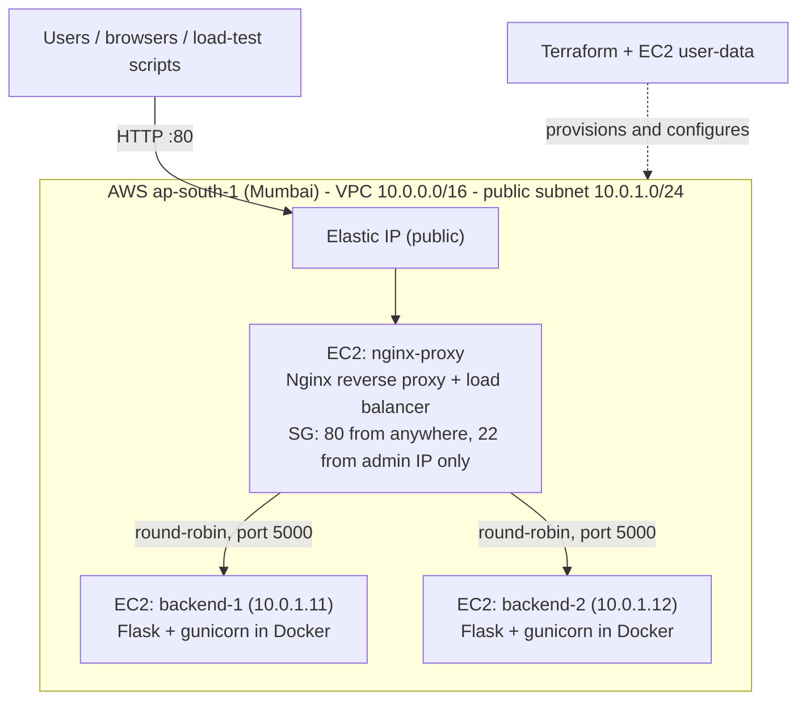

# Reverse Proxy and Load Balancer on AWS

**DEV SPRINT'26 DevOps Hackathon — Problem 27: Reverse Proxy and Load Balancer**

Two backend application instances run behind an Nginx reverse proxy on AWS. Nginx spreads incoming
requests across both backends and keeps serving users when one backend server goes down.
The whole environment is defined as code with Terraform and boots itself with EC2 user-data.

**Live demo:** http://65.0.137.154/ (only while the AWS environment is running; the IP changes if it is destroyed and recreated)

---

## Contents

- [Problem statement](#problem-statement)
- [Architecture](#architecture)
- [How it works](#how-it-works)
- [Tech stack](#tech-stack)
- [Repository structure](#repository-structure)
- [Deploy it](#deploy-it)
- [Test it](#test-it)
- [Results](#results)
- [Live demonstration](#live-demonstration)
- [Security](#security)
- [Limitations and future work](#limitations-and-future-work)

---

## Problem statement

> Deploy two backend application instances behind a reverse proxy that distributes incoming requests
> and continues serving requests when one backend becomes unavailable.

| Minimum requirement | How this project meets it |
|---|---|
| Two distinguishable backend instances | Two EC2 servers run the same Flask image with different identities (`backend-1` blue, `backend-2` green). Every response carries the server name, private IP and EC2 instance ID. |
| Nginx as a reverse proxy | A dedicated EC2 instance runs Nginx; it is the only server reachable from the internet. |
| A load-balancing strategy | Round-robin across an `upstream` pool, with passive health checks and automatic retry. |
| Identify which backend handled each request | Response body, `X-Backend-Server` and `X-Upstream-Addr` headers, and `$upstream_addr` in the Nginx access log. |
| Test with one backend unavailable | The whole backend-1 EC2 instance is stopped and started while traffic flows; results are in [`docs/`](docs). |
| Accessible externally | Public Elastic IP on the proxy, port 80 open to the internet. |

---

## Architecture



| Component | Details |
|---|---|
| Nginx proxy | `t3.micro`, Amazon Linux 2023, Elastic IP, security group allows 80 from anywhere and SSH only from the operator's IP |
| backend-1 / backend-2 | `t3.micro`, Amazon Linux 2023, fixed private IPs `10.0.1.11` / `10.0.1.12`, security group allows port 5000 and SSH **only from the proxy's security group** |
| Network | Custom VPC, one public subnet, internet gateway, route table |
| Provisioning | Terraform creates 20 resources; user-data scripts install Docker/Nginx and start everything on first boot |

---

## How it works

### Normal request flow

1. The client sends `GET http://<elastic-ip>/` to the Nginx proxy.
2. Nginx picks the next backend from the `upstream` pool (round-robin: 1, 2, 1, 2, …).
3. The request is forwarded to that backend's **private** IP on port 5000.
4. The Flask app answers with its own identity (name, private IP, instance ID, request count).
5. Nginx returns the response and adds `X-Upstream-Addr` (which backend it used) and `X-LB-Algorithm`.

### When a backend fails

```text
request -> Nginx picks backend-1 -> no answer within 2 s (proxy_connect_timeout)
        -> proxy_next_upstream: same request retried on backend-2 -> 200 OK to the user
        -> after 2 failures (max_fails=2) backend-1 is marked down for 10 s (fail_timeout)
        -> all traffic goes to backend-2 with no extra delay
        -> every 10 s Nginx tries backend-1 again; once it answers, round-robin resumes automatically
```

### Key Nginx settings ([`nginx/nginx.conf.tftpl`](nginx/nginx.conf.tftpl))

| Setting | Purpose |
|---|---|
| `upstream backend_pool { server …; server …; }` | Load-balancing pool; no algorithm directive = round-robin |
| `max_fails=2 fail_timeout=10s` | Passive health check: mark a backend down after 2 failures, re-check after 10 s |
| `proxy_next_upstream error timeout http_502 http_503 http_504` | Transparently retry a failed request on the other backend |
| `proxy_connect_timeout 2s` | Fail fast: a stopped server drops packets silently, and the 60 s default would stall users |
| `keepalive 64` (upstream) | Reuse connections to the backends instead of opening one per request |
| `worker_connections 4096`, `listen … backlog=4096` | Headroom for bursts of ~1,000 simultaneous requests |
| `log_format … upstream=$upstream_addr …` | Every access-log line records which backend served the request |

Open-source Nginx only supports **passive** health checks (active checks are an Nginx Plus feature),
so the retry and short timeout are what keep failures invisible to users.

### Backend ([`backend/`](backend))

- Python 3.12, Flask 3.1, served by gunicorn (3 processes × 16 threads) in a Docker container running as a non-root user.
- One image for both backends; identity comes from environment variables (`SERVER_NAME`, `SERVER_COLOR`, `PRIVATE_IP`, `INSTANCE_ID`, `AZ`).
- Endpoints:

| Endpoint | Returns |
|---|---|
| `GET /` | Live dashboard in a browser; JSON for `curl` and scripts |
| `GET /api` | JSON: server, hostname, private IP, instance ID, AZ, request count, uptime. Optional `?work=<ms>` simulates processing time (max 2000 ms) |
| `GET /health` | `{"status": "ok", "server": "<name>"}` |

### Live dashboard

Open the live URL in a browser:

- **Dashboard:** send 1 / 10 requests, auto traffic, and a **load test** (up to 5,000 requests, configurable concurrency) with throughput, success/failure, split per backend and p50/p95/p99 latency. A live timeline shows which backend served each request; failed requests turn red and requests Nginx retried are outlined.
- **Server Info:** hostname, private IP, instance ID, AZ, uptime and request count for each backend.
- **Health:** live checks of Nginx (`/nginx-health`) and of the backend pool (`/health`), plus the failover settings.

---

## Tech stack

| Area | Technology |
|---|---|
| Cloud | AWS EC2, VPC, security groups, Elastic IP (region `ap-south-1`) |
| Infrastructure as code | Terraform (AWS provider 6.x) |
| Configuration | EC2 user-data (bash), Amazon Linux 2023 |
| Reverse proxy / load balancer | Nginx (open source) |
| Backend | Python 3.12, Flask 3.1, gunicorn |
| Containers | Docker |
| Testing | pytest, PowerShell and bash test scripts, Python load tester (standard library only) |

---

## Repository structure

```text
.
├── backend/                     Flask app, dashboard, Dockerfile, unit tests
│   ├── app.py
│   ├── templates/dashboard.html
│   ├── static/dashboard.js, dashboard.css
│   ├── Dockerfile, requirements.txt
│   └── tests/test_app.py
├── nginx/
│   └── nginx.conf.tftpl         Nginx config (Terraform template; backend IPs injected at deploy)
├── terraform/
│   ├── versions.tf              providers
│   ├── variables.tf             region, instance type, backend IPs/colours, ...
│   ├── main.tf                  VPC, subnet, routing, security groups, SSH key
│   ├── instances.tf             2 backends, Nginx proxy, Elastic IP
│   ├── outputs.tf               URL, SSH commands, stop/start commands
│   └── templates/               user-data bootstrap scripts
├── scripts/
│   ├── test-distribution.ps1/.sh        N requests, count per backend
│   ├── test-failover.ps1/.sh            stop/start backend-1 under light traffic
│   ├── test-failover-under-load.ps1     stop/start backend-1 under sustained load
│   ├── load-test.py                     parallel load tester with timeline
│   └── common.ps1
└── docs/                        recorded test results
```

---

## Deploy it

### Prerequisites

- An AWS account and an IAM user with access keys (not the root account)
- [Terraform](https://developer.hashicorp.com/terraform/install) ≥ 1.6 and [AWS CLI v2](https://aws.amazon.com/cli/)
- Python 3 (for the load tester)

```bash
aws configure                 # access key, secret key, region ap-south-1, output json
aws sts get-caller-identity   # should print your IAM user
```

### Steps

```bash
cd terraform
terraform init       # download providers
terraform plan       # preview the 20 resources that will be created
terraform apply      # create them (about 1 minute)
```

Terraform prints the outputs, including `app_url`. The servers configure themselves on first boot
(install Docker / Nginx, build and start the app); the site answers on `app_url` after about **3 minutes**.

Useful outputs:

```bash
terraform output app_url
terraform output backend_instance_ids
terraform output ssh_proxy        # SSH into the proxy
terraform output ssh_backend_1    # SSH into backend-1 through the proxy (jump host)
```

### Tear down (stops all charges)

```bash
terraform destroy
```

Cost while running is roughly **US$0.06/hour** (3 × `t3.micro`, 3 public IPv4 addresses, 3 small disks).

---

## Test it

### Unit tests

```bash
pip install -r backend/requirements.txt pytest
python -m pytest -q backend/tests
```

### Load distribution

```bash
# PowerShell
.\scripts\test-distribution.ps1 -Count 20
# bash
./scripts/test-distribution.sh
```

### Parallel load test

```bash
python scripts/load-test.py -n 1000 -c 200          # 1,000 requests, 200 at a time
python scripts/load-test.py -n 1000 -c 1000         # all 1,000 at once
python scripts/load-test.py --duration 120 -c 100   # sustained load with a 5-second timeline
```

### Failover

```bash
# Light traffic: stops and restarts the whole backend-1 EC2 instance, writes docs/results.md
.\scripts\test-failover.ps1

# Under sustained load (100 concurrent clients), writes docs/failover-under-load.md
.\scripts\test-failover-under-load.ps1 -Duration 150 -Concurrency 100
```

The scripts read the URL and instance IDs from `terraform output`, so they keep working after a redeploy.

---

## Results

All tests ran against the live AWS deployment.

### Load distribution — 1,000 requests

| Test | Succeeded | Failed | backend-1 | backend-2 |
|---|---|---|---|---|
| 1,000 requests, 200 concurrent | 1,000 | 0 | 500 | 500 |
| 1,000 requests, 1,000 concurrent | 1,000 | 0 | 500 | 500 |

### Failover under load — [`docs/failover-under-load.md`](docs/failover-under-load.md)

100 concurrent clients for 150 seconds; the **whole backend-1 EC2 instance** was stopped and then started again during the run.

| Total requests | Succeeded | Failed | Retried by Nginx |
|---|---|---|---|
| 101,521 | 101,521 | **0** | 17 |

| Phase | What the traffic did |
|---|---|
| Both backends up | Even split, ~1,600 / ~1,600 requests per 5 s |
| backend-1 stopped | backend-1 dropped to 0 immediately; backend-2 served everything; 0 failures |
| backend-1 started again | Back in rotation about 24 s after the start command, with no change to Nginx |

A lighter-traffic failover run is in [`docs/results.md`](docs/results.md) (114 requests, 0 failed).

**Note on latency:** in the 1,000-concurrent tests the slowest ~5% of requests took around 1 s or more.
These match TCP connection-setup retries when one client machine opens a thousand connections at once;
every request still succeeded.

---

## Live demonstration

1. Open the live URL and press **Send 10**: requests alternate between backend-1 (blue) and backend-2 (green).
2. Press **Reset**, then **Start auto traffic**.
3. AWS Console → EC2 → Instances (region Mumbai) → select `lb-demo-backend-1` → **Instance state → Stop instance**.
4. On the dashboard the timeline turns all green, backend-1 shows **Not responding**, and **Failed stays at 0**.
5. **Instance state → Start instance**: about a minute later backend-1 is back and traffic is shared again.

> Stop only one backend at a time. Stopping both backends, or the proxy, takes the site down.
> Use **Stop**, never **Terminate** (terminate deletes the server; `terraform apply` would recreate it).

---

## Security

- Backends have no inbound access from the internet; ports 5000 and 22 are open only to the proxy's security group.
- SSH to the proxy is limited to the operator's public IP (detected automatically by Terraform); backends are reached through the proxy as a jump host.
- EBS volumes are encrypted; IMDSv2 is enforced on all instances.
- The app container runs as a non-root user; Nginx hides its version (`server_tokens off`).
- Deployment uses a dedicated IAM user, not the root account.
- The SSH private key and Terraform state are git-ignored and never committed.

---

## Limitations and future work

| Limitation | Possible improvement |
|---|---|
| The Nginx proxy is a single point of failure | Second Nginx with keepalived / floating IP, or an AWS Network Load Balancer in front |
| Passive health checks only | Shared `zone` in the upstream so all Nginx workers share failure state; Nginx Plus or a sidecar for active checks |
| HTTP only | HTTPS with Let's Encrypt |
| Backends in a public subnet (outbound internet for setup) | Private subnets with a NAT gateway |
| Manual deploys replace instances (short downtime) | Rolling deployment one backend at a time; Auto Scaling group |
| App files shipped in user-data (16 KB limit) | Container image in Amazon ECR, or files in S3 |
| No CI/CD, no central monitoring | GitHub Actions for tests and deploy; CloudWatch logs, metrics and alarms |
