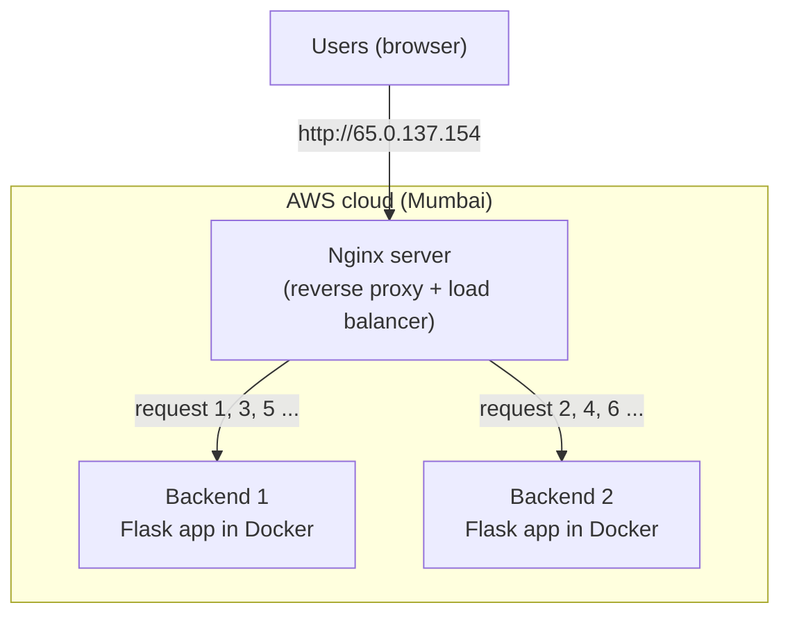

# Reverse Proxy and Load Balancer on AWS

**DEV SPRINT'26 DevOps Hackathon — Problem 27**

**Live demo:** http://65.0.137.154/

---

## Problem statement

Deploy two backend application instances behind a reverse proxy that distributes incoming requests
and continues serving requests when one backend becomes unavailable.

The project must:

- create two backend servers that can be told apart,
- use Nginx as a reverse proxy,
- share the incoming requests between the two backends,
- show which backend handled each request,
- keep working when one backend is stopped,
- be reachable from the internet.

---

## What it does

Users open one website address. Behind it there are **two servers** running the same app.
**Nginx** sits in front of them, receives every request and passes it to one of the two servers,
taking turns. If one server stops, Nginx sends all requests to the other one, so users still get
a response. When the stopped server comes back, Nginx starts using it again automatically.

Think of a restaurant: Nginx is the receptionist and the two backends are two cooks.
Orders are shared between the cooks, and if one cook goes home, every order goes to the other cook.

---

## Architecture

- **3 servers on AWS EC2:** one Nginx server and two backend servers.
- Only the **Nginx server** can be reached from the internet. The backends are private.
- Everything is created with **Terraform** using a single command.

---

## How it works

1. A user opens the website. The request goes to the **Nginx** server.
2. Nginx sends the request to **backend-1** or **backend-2**, taking turns (1, 2, 1, 2 …). This is called **round-robin**.
3. The backend replies with its **name, IP address and server ID**, so we can see who answered.
4. Nginx sends the reply back to the user.

**When a backend stops:**

1. Nginx tries to reach the stopped backend and gets no answer within 2 seconds.
2. Nginx **automatically resends the same request** to the other backend, so the user still gets a reply.
3. After 2 failed tries, Nginx stops sending requests to the stopped backend.
4. Every 10 seconds Nginx checks it again. When it is back, Nginx uses it again.

---

## Features

- **Two backend servers** that each show their own name and colour (backend-1 blue, backend-2 green).
- **Load balancing** with Nginx: requests are shared equally between the two backends.
- **Automatic failover:** if one backend stops, the other one serves everyone with no errors.
- **Automatic recovery:** a backend that comes back is added back by itself.
- **Live dashboard** in the browser:
  - send 1 or 10 requests, or start continuous traffic,
  - see which backend answered each request (coloured timeline and request log),
  - run a **load test** of up to 5,000 requests,
  - see server details and health status.
- **Load test script** that can send 1,000 requests at the same time.
- **Failover test scripts** that stop a backend server on AWS and record the results.
- **Infrastructure as code:** the network, firewall rules and all 3 servers are created by Terraform.

---

## Tools used

| Tool | Used for |
|---|---|
| AWS EC2 | The 3 cloud servers |
| Nginx | Reverse proxy and load balancer |
| Python Flask | The backend app and dashboard |
| Docker | Running the backend app in a container |
| Terraform | Creating all AWS resources with one command |
